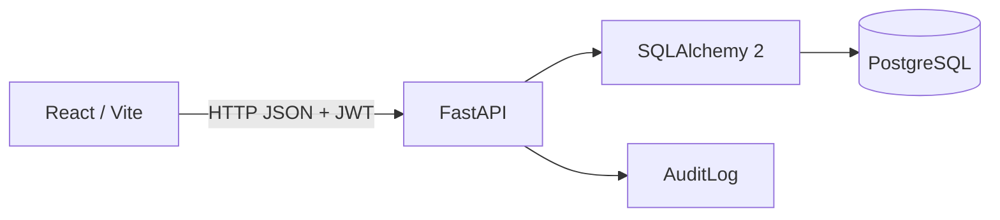
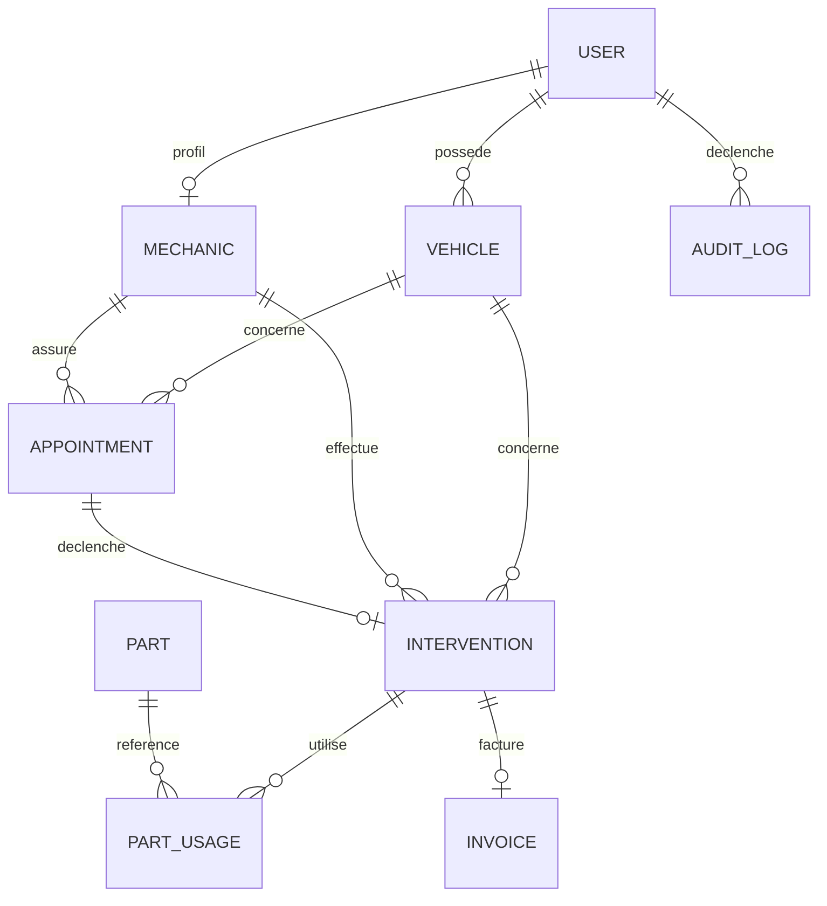

# Conception — GaragePro

## Objectif

Application web de gestion d'un garage, accessible à trois profils : client, mécanicien et administrateur. Le frontend React appelle une API REST FastAPI. Les données sont persistées dans PostgreSQL (Docker) ou SQLite (démonstration locale).

## Architecture

La séparation backend/frontend et les routes sous `/api` facilitent l'extension des fonctions et de la stratégie de tests. Ce projet reste intentionnellement compact : modèles et routes sont rassemblés dans `backend/app/main.py` pour faciliter la prise en main, et pourront être séparés en modules (`models`, `schemas`, `routers`, `services`) lors de la phase de maintenabilité.

## Entités et relations

Entités métier gérées : `Vehicle`, `Mechanic`, `Part`, `Appointment`, `Intervention`, `Invoice`. Entités transverses : `User`, `PartUsage`, `AuditLog`.

## Endpoints principaux

| Route | Usage |
|---|---|
| `POST /api/auth/register` | Créer un compte CLIENT |
| `POST /api/auth/login` | Authentification |
| `GET /api/auth/me` | Profil courant |
| `GET/POST /api/users` | Comptes et création ADMIN |
| `GET/POST/PUT/DELETE /api/vehicles` | Véhicules |
| `GET/POST/PUT/DELETE /api/mechanics` | Mécaniciens |
| `GET/POST/PUT/DELETE /api/parts` | Pièces |
| `GET/POST/PUT/DELETE /api/appointments` | Rendez-vous |
| `GET/POST/PUT/DELETE /api/interventions` | Interventions |
| `PATCH /api/interventions/{id}/status` | Changer le statut |
| `GET/POST /api/interventions/{id}/parts` | Pièces consommées |
| `GET/POST/PATCH /api/invoices` | Factures et paiements |
| `GET /api/dashboard` | Statistiques filtrées par rôle |
| `GET /api/audit` | Journal administrateur |

Les chemins avec `/{id}` sont listés de manière abrégée : voir `/docs` pour leurs signatures exactes.

## Points de sécurité

- Hachage PBKDF2-SHA256 avec sel aléatoire et comparaison en temps constant.
- JWT signé HS256 avec expiration (huit heures) ; secret configurable.
- Contrôle d'accès serveur par rôle et propriétaire (non seulement dans le frontend).
- Validation de données Pydantic et requêtes paramétrées SQLAlchemy.
- Log des actions sensibles dans la même transaction que la mutation.

## Limites conscientes du prototype

- Pas de récupération de mot de passe, gestion des profils avancée ou administration des utilisateurs existants.
- Pas de passerelle de paiement : le paiement est confirmé manuellement par l'administrateur.
- Le risque de chevauchement simultané des rendez-vous devrait être renforcé par une contrainte d'exclusion PostgreSQL dans une version production.
- SQLite ne prend pas en charge le verrouillage `FOR UPDATE` ; utiliser PostgreSQL pour le contrôle de stock concurrent.
- Aucun test ou rapport d'exécution n'est fourni dans ce ZIP, conformément à la demande.
